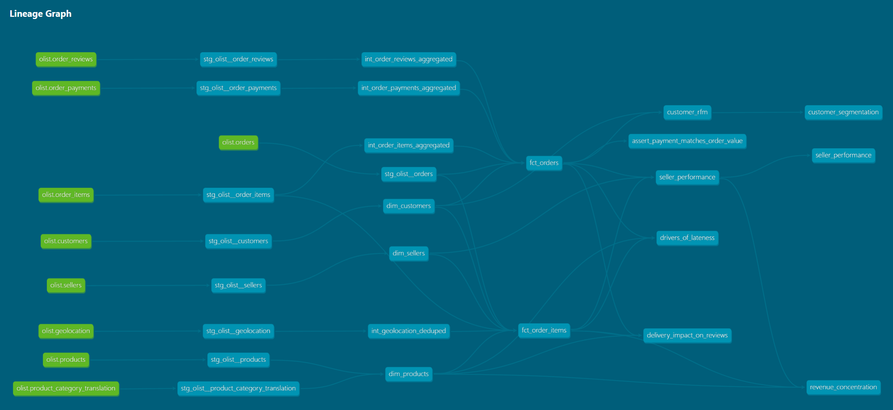
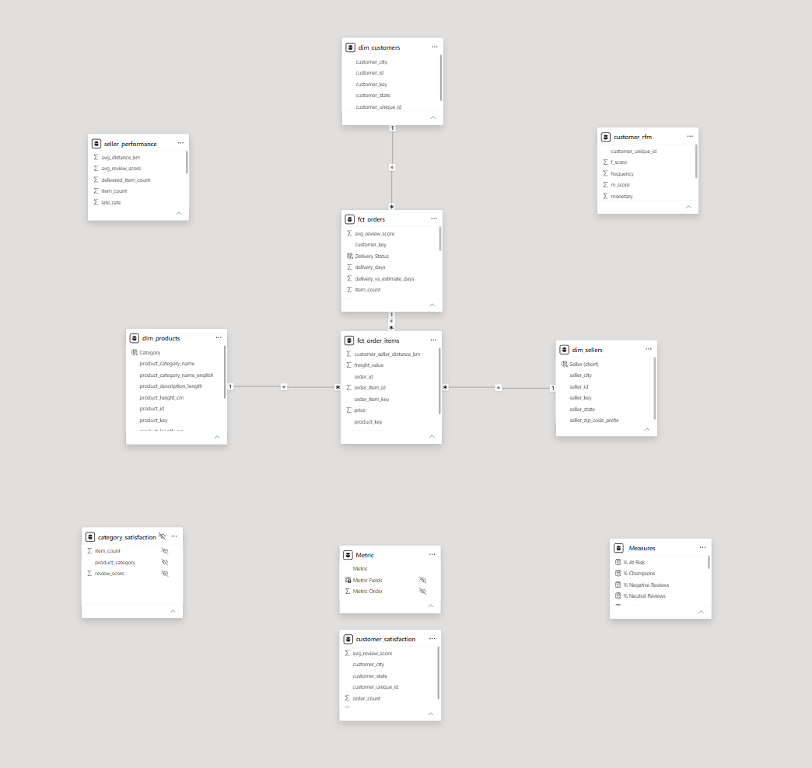
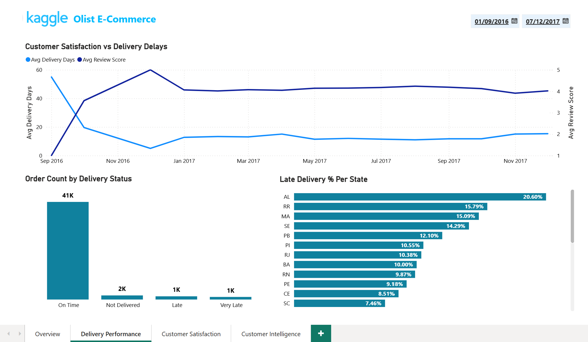
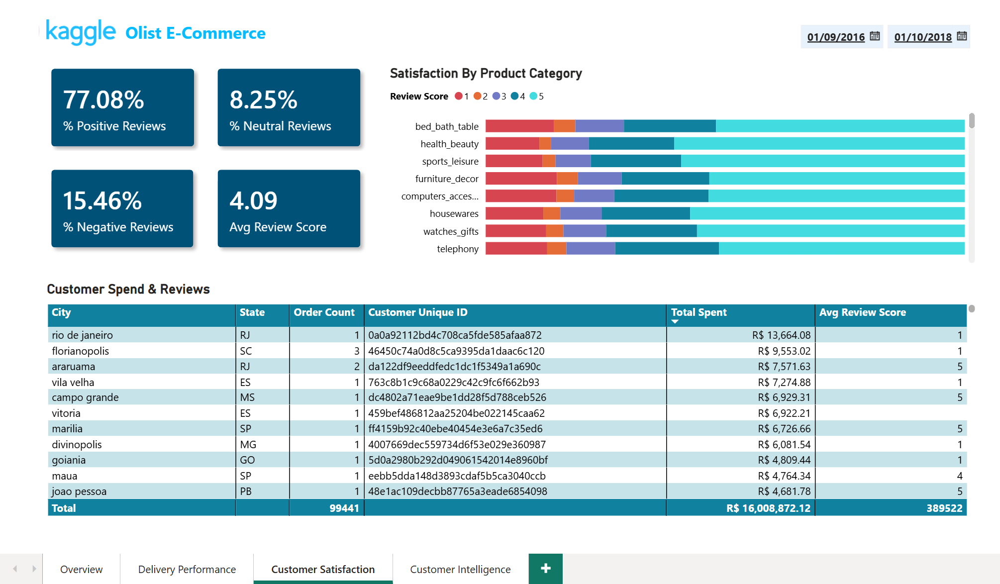
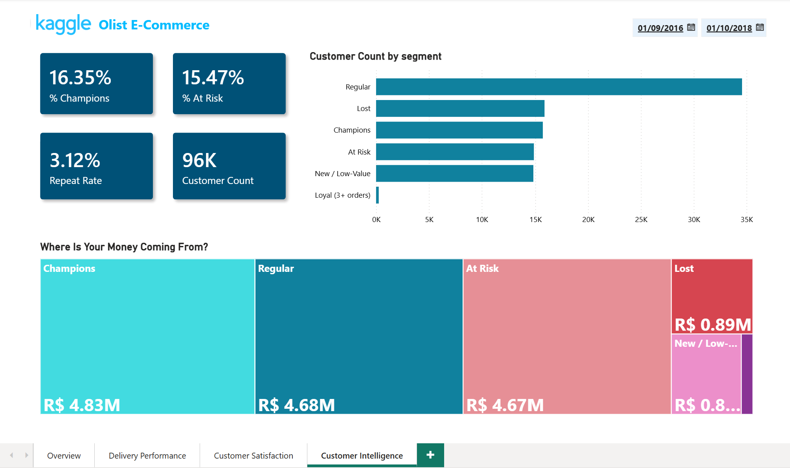

# 电商分析工程作品集（dbt + DuckDB）


基于公开的 [Olist](https://www.kaggle.com/datasets/olistbr/brazilian-ecommerce) 巴西电商数据集（约 10 万订单、9 张关联表）搭建的端到端分析工程项目。它在 Kimball 星型模型之上构建了一套经过测试、文档齐全的 dbt 项目，并以此回答真实的业务问题。每条洞察都按「发现 — 证据 — 影响 — 建议」的结构组织。

项目的侧重点是生产级分析真正重要的东西：正确的数据粒度、代理键与引用完整性测试、对数据局限的诚实交代，以及把相关性和因果性区分开的结论。

## 目录

- [这个项目展示了什么](#这个项目展示了什么)
- [数据集及其局限](#数据集及其局限)
- [架构](#架构)
- [项目结构](#项目结构)
- [洞察](#洞察)
- [看板](#看板)
- [范围与刻意排除的内容](#范围与刻意排除的内容)
- [如何运行](#如何运行)
- [如果团队协作我会补充什么](#如果团队协作我会补充什么)
- [数据与许可](#数据与许可)

## 这个项目展示了什么

- 三层 dbt 项目：staging、intermediate、marts（23 个模型、89 项测试、9 个数据源）。
- Kimball 星型模型：3 个维度表和 2 张不同粒度的事实表，通过代理键关联，并用 `relationships` 测试保证引用完整性。
- 通用测试（`unique`、`not_null`、`accepted_values`、`relationships`、`dbt_utils` 复合键与范围测试），外加一个以 WARN 级别运行的单值数据质量测试。
- 基于 marts 构建的四页 Power BI 看板（概览、配送表现、客户满意度、客户智能），面向业务受众呈现发现。
- 刻意的范围控制：把「没有做什么、为什么」写进文档，而不是默认全做。

## 数据集及其局限

Olist 是真实的市场导出数据，因此它带着生产数据常见的杂乱。有三点局限是被显式处理、而非忽略的：

1. **没有真实成本或毛利。** 数据里有 `price`、`freight_value` 和 `payment_value`，但没有商品成本。因此不计算利润或毛利；所有收入数字均为商品交易总额（GMV，即商品价格）。
2. **`customer_id` 是订单级、不是人级。** Olist 对每笔订单都会生成新的 `customer_id`，真正的自然人是 `customer_unique_id`。所有人级分析（RFM、复购率）都使用 `customer_unique_id`，`customer_id` 仅作为订单键。
3. **复购率低。** 只有约 3% 的客户下单超过一次，这限制了留存和频次分析能得出的结论。在所有相关处都已说明这一点，并据此做出了刻意的建模决策（见[范围与刻意排除的内容](#范围与刻意排除的内容)）。

## 架构



*由 `dbt docs` 渲染的完整项目血缘：绿色源表，然后是 `stg_olist__*`、`int_*` 聚合、星型模型，最右侧是分析 mart 与分析。*

- **Staging** 以视图物化，每个源表一个模型，采用经验式类型处理（例如，只有在没有任何行带时间分量时，才把日期转为 `DATE`）。
- **Intermediate** 存放订单粒度的商品、支付、评论聚合，以及一个地理模型——把巴西邮编前缀坐标去重为每个前缀的单一质心。
- **Marts** 以表物化。星型模型使用 `dbt_utils.generate_surrogate_key` 生成的代理键；事实表通过这些键引用维度表，`relationships` 测试验证每个键都能解析。`fct_order_items` 还携带了基于去重地理信息计算的客户到卖家大圆（haversine）距离。

## 项目结构

```text
.
├── models/
│   ├── staging/          # stg_olist__*  （视图，每个源表一个）
│   ├── intermediate/     # int_*  （订单粒度聚合、地理去重）
│   └── marts/            # 星型模型（fct_*, dim_*）外加专用分析 mart（含 delivery_risk）
├── analyses/             # 六条业务分析（编译后读取已构建的 marts）
├── tests/                # 单值数据质量测试
├── powerbi/              # mart 导出脚本与 Power BI 看板（.pbix）
├── docs/
│   └── images/           # DAG、Power BI 模型视图、看板截图
├── dbt_project.yml
├── packages.yml
└── README.md
```

## 洞察

六条超越描述层面的分析。每条都按「发现 — 证据 — 影响 — 建议」组织，并从 `/analyses` 中读取已构建的 marts。

| # | 问题 | 核心发现 |
|---|------|----------|
| 1 | 延迟交付会影响满意度吗？ | 错过承诺日期会让评分下降约 2.5 星，且该效应在控制品类、重量和距离后依然成立。 |
| 2 | 是什么导致迟到？ | 是距离，而非商品或卖家质量。迟到率从短途到长途翻了一倍多。 |
| 3 | 收入集中在哪里？ | 在卖家而非品类。头部 10% 的卖家贡献了 67.6% 的 GMV。 |
| 4 | 客户价值如何分布？ | 价值高度集中，但约 97% 的客户只买一次，因此 RFM 是描述性的，不是留存漏斗。 |
| 5 | 支付能和订单金额对上吗？ | 387 单（约 0.4%）对不上，全部可用分期利息和代金券解释。 |
| 6 | 迟到是卖家问题还是运输问题？ | 只有 27.6% 的迟到订单可归因于超期交运；但超期 7 天以上仍会让订单迟到概率变为 11 倍。 |

以下所有数字均由 `/analyses` 中的分析产出，它们读取已构建的 marts。

### 1. 延迟交付与更低的评分相关

- **发现：** 错过承诺交付日期与评分大幅下降相关，约 2.5 星。
- **证据：** 按「交付相对预估日期」分组的平均评分：提前 4.29、准时 4.04、迟到 1–5 天 2.99、迟到 6–15 天 1.74、迟到 15 天以上 1.73。下降平稳，且在「准时到略微迟到」的边界处最陡。提前送达的评分高于刚好准时送达。
- **稳健性：** 同样的下降在商品品类内、重量带内、距离带内都成立。距离本身影响很小（整个区间约 0.1 星），但迟到的影响大约是它的二十倍，且在三类控制下依然存在。相关性是站得住的；不主张因果性（卖家和价格未控制）。
- **影响：** 迟到订单只占约 6.7% 的量，却产生了大部分拉低平台评分的 1 星和 2 星评价。
- **建议：** 优化目标是「赶上承诺日期」，而非纯粹的速度。大多数订单已经提前送达，因此重点是那一小部分迟到订单：给出更现实的预估，并标记可能迟到的运单，尤其是长途运单。

### 2. 迟到由距离驱动，而非商品或卖家质量

- **发现：** 迟到的驱动因素是结构性和地理性的。
- **证据：** 迟到率随客户到卖家的距离攀升，从 100km 以内的 4.5% 到 1000km 以外的 10.3%。偶尔会出现尖峰（2017 年 11 月黑色星期五前后 12.4%，以及 2018 年 3 月异常的 19.0%）。重量只在 10kg 以上的尾部才有影响。品类可忽略（全部在 6.3% 到 8.0% 之间）。卖家是分散的，并非集中：在有 20 单以上已送达商品的 881 个卖家中，只有 11 个长期迟到。
- **影响与建议：** 最有效的修复是缩短长途线路（从最近的卖家发货），然后在已知高峰期增加运力并放宽预估。对迟到率处于 10–25% 区间的约 166 个卖家进行辅导是值得的；但批量清退卖家不是好办法，因为「总是迟到」的群体很小。洞察 6 进一步拆分了这一点：只有约四分之一的迟到订单可归因于卖家的交运环节，所以距离这个杠杆主要作用在运输上。

### 3. 收入集中在卖家，而非品类

- **发现：** 收入风险是供给侧（卖家）的故事，而非需求侧（品类）的故事。
- **证据：** 头部 10% 的卖家（3,095 中的 310 个）贡献了 67.6% 的 GMV，头部 20% 达到 82.7%，而底部一半卖家合计仅贡献约 2%。收入在品类间分散：没有任何单一品类超过收入的 9.3%，前 5 个品类约占 40%，需要约 20 个（共 72 个）品类才能达到 80%。
- **建议：** 把头部几百个卖家当作重点客户维护，因为留住他们就守住了三分之二的 GMV。品类策略可以保持宽泛，因为没有单一品类占主导。卖家质量不随规模变化，因此没有理由限制大卖家。

### 4. 客户价值集中，但客群以一次性买家为主

- **发现：** RFM 分段让价值集中，但数据集以单次购买为主。
- **证据：** 约 97% 的客户只下过一次单，因此「频次」维度几乎没有信号，由「最近购买」和「金额」承担主要区分作用（也因此频次用 `CASE` 分层，而非 `NTILE`）。重要价值客户（Champions）占客户的 16.4%，但占收入的 30.2%；有流失风险客户（At-Risk）占客户的 15.5%，但占收入的 29.2%。
- **建议：** 这些分段是描述性的价值层级，可用于排定营销支出的优先级，而不是一个实时的留存漏斗。「有流失风险」的收入数字是有限的，因为大多数一次性买家不会再回来。

### 5. 数据质量：支付对账

- **发现：** 387 单（约 0.4%）的支付总额不等于商品价格加运费。
- **证据：** 294 单多付（平均 +R$10.44，与分期利息一致），93 单少付（平均 −R$2.15，与代金券和折扣一致）。
- **处理：** 由一个以 WARN 级别运行的单值测试捕获。这些是真实的支付机制，因此正确的做法是把它们暴露并解释，而不是让构建失败。

### 6. 迟到主要是运输问题，而非超期交运

- **发现：** 在卖家自己的截止日期之后发货很少见，但每多超期一天，配送错过承诺日期的概率都会急剧上升。不过这仍只占迟到故事的约四分之一。
- **证据：** 96,469 个已送达订单中，有 8,563 个（8.9%）是在 `max(shipping_limit_timestamp)` 之后才交给承运商的；超期中位数为 1 天、P90 为 7.8 天，所以大多数只是小幅拖延。迟到率随超期幅度单调上升：按时交运 5.4%、超期 1 天以内 11.6%、1–3 天 17.5%、3–7 天 25.4%、7 天及以上 59.8%。
- **归因：** 在 6,533 个迟到配送中，4,729 个（72.4%）是按时交运、在运输中变迟的；只有 1,804 个（27.6%）可归因于超期交运。即使是超期订单，仍有 78.9% 的概率准时送达。
- **所处位置：** 超期比例在各距离带上基本持平（100km 以内 9.5%，1000km 以外 9.2%），说明卖家并不会系统性地拖延远距订单。距离效应体现在运输上：在按时交运的订单中，迟到率从 2.4% 到 8.2%。卖家尾部很小但可点名：在有 20 单以上已送达订单的 804 个卖家中，75 个超期率超过 25%（6,812 单），232 个超过 10%。各州的超期率保持在 6.7% 到 10.1% 之间，而迟到率从 4.0%（PR）到 17.4%（MA）不等。2018 年 3 月是最干净的检验：超期率 8.4%（正常）但迟到率 19.0%，因此那次尖峰纯粹是运输问题。
- **影响：** 卖家纪律是可控的那四分之一；它修不好另外的四分之三，也限定了卖家辅导项目能带来的上限。
- **建议：** 把交运环节和运输环节分开度量，对突破发货截止日期的订单当天就告警（而不是等配送迟到了才发现），辅导那 75 个已点名的卖家，并把 MA/CE/BA 的长途线路当作承运商问题来处理。`delivery_risk` mart（月 × 州 × 距离带）正是为驱动这个视图而构建的。

## 看板

一个直接构建在 dbt marts 之上的四页 Power BI 看板。它面向业务受众呈现上述发现，并增加了交互能力：同步的日期筛选器，以及一个可同时驱动多个图表的「收入/订单量」切换。

事务型页面读取星型模型。为了把评分与客户消费、与商品品类、与履约的「月/州/距离」形态放在同一张表里，新增了三个小型专用 mart：`customer_satisfaction`、`category_satisfaction` 和 `delivery_risk`——因为星型模型把这些信息分散在不同粒度的表上。用一张宽分析表来跨粒度聚合，比在 BI 层强行建立双向关系更合理。这与项目其他地方的判断一致：事务模型用星型模型，而需要不同粒度的问题用专用 mart。

加载到 Power BI 的模型就是 dbt 星型模型本身：事实表通过代理键关联到其维度表，一对多、单向。聚合 mart 作为独立数据源，供各自的页面使用。



**概览。** 头部 KPI、与平均评分并列展示的收入趋势，以及带「收入/订单量」切换的头部卖家和品类。


**配送表现。** 准时率与迟到率、配送状态分布，以及按时间和按州的迟到率。洞察 2 背后的运营视图。



**客户满意度。** 按交付结果的评分（洞察 1 的级联）、按商品品类的评分构成，以及一张值得挽留的高消费低满意度客户表。



**客户智能。** 洞察 4 的 RFM 分段：收入按分段来自哪里，以及一张「最近购买 vs 消费金额」的客户全景图。



## 范围与刻意排除的内容

有两件事被刻意排除在外，而排除的理由也是工作的一部分：

- **没有流失、生命周期价值或留存模型。** 约 3% 的复购率支撑不了可靠的流失或 CLV 模型：约 97% 的客户只有一笔订单，没有可学习的复购行为信号。这里的 RFM 是描述性分群，不是留存漏斗。
- **没有利润或毛利。** 源数据中没有商品成本，任何毛利数字都将是编造的。所有收入均为商品交易总额（GMV），并已如实标注。

## 如何运行

数仓是 DuckDB，因此整个项目无需云账号即可在本地构建。

**前置条件：** [uv](https://docs.astral.sh/uv/)，以及放在 `/data` 下的 Olist CSV（已被 gitignore，Kaggle slug 为 `olistbr/brazilian-ecommerce`）。

```bash
# 1. 安装依赖与 dbt 包
uv sync
uv run dbt deps

# 2. 构建并测试（依次运行每个模型，然后运行每项测试）
uv run dbt build

# 3. 生成文档站点与血缘图
uv run dbt docs generate
uv run dbt docs serve

# 4. 可选：把 marts 导出到 /powerbi/exports 供 Power BI 使用
uv run python powerbi/export_marts.py
```

`olist.duckdb` 和 `/data` 都被 gitignore，因此全新 clone 后，首次构建前需要先把 CSV 放到位。

## 如果团队协作我会补充什么

这是一个静态的、单人项目，因此没有包含生产监控。如果是团队项目，还会有：

- `sqlfluff` 和 pre-commit 钩子，在每次提交时做风格与 lint 检查。
- `dbt-checkpoint` 和 `dbt-project-evaluator`，用于约束文档覆盖率和最佳实践。
- 一个在每个 PR 上运行 `dbt build` 和 lint 的 CI 工作流。
- 在公开 mart 上加模型 `contracts`。
- Elementary 加上对生产运行的告警。

这些在有多人依赖这个项目时都值得加；在单人项目里加上反而是过度设计。

## 数据与许可

[Olist 巴西电商公开数据集](https://www.kaggle.com/datasets/olistbr/brazilian-ecommerce)由 Olist 在 Kaggle 上以 [CC BY-NC-SA 4.0](https://creativecommons.org/licenses/by-nc-sa/4.0/) 许可发布。原始数据不在此重新分发；它从 Kaggle 下载并排除在版本控制之外（见[如何运行](#如何运行)）。这是一个非商业的教育项目，任何由数据衍生的产出都继承该数据集的许可。

本仓库的代码以 MIT 许可发布（见 [`LICENSE`](LICENSE)）。
